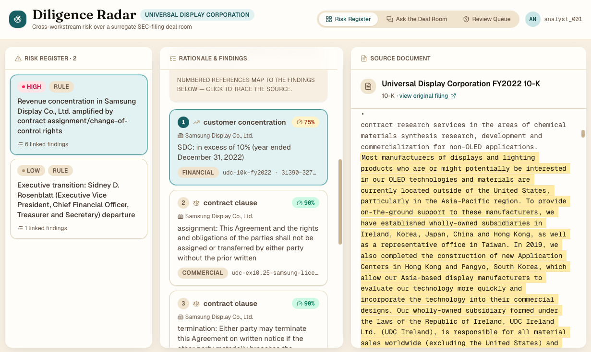
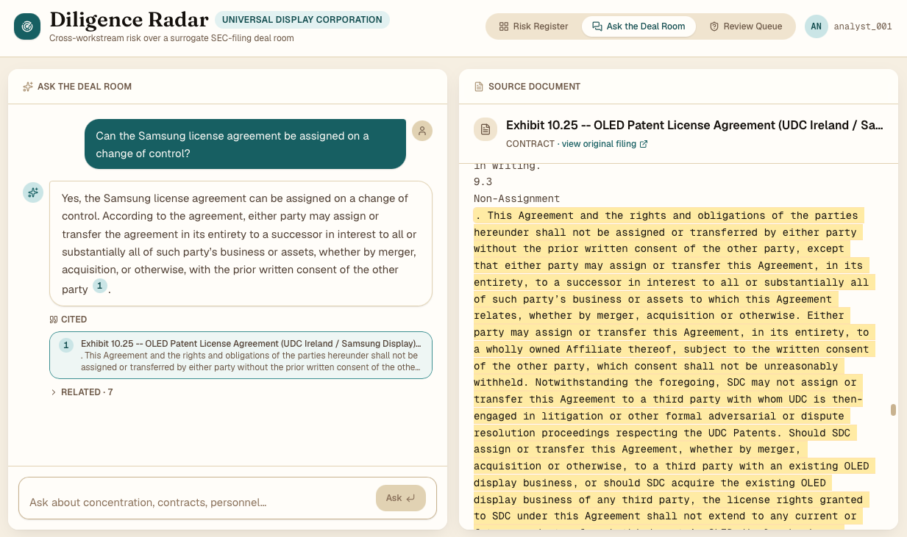
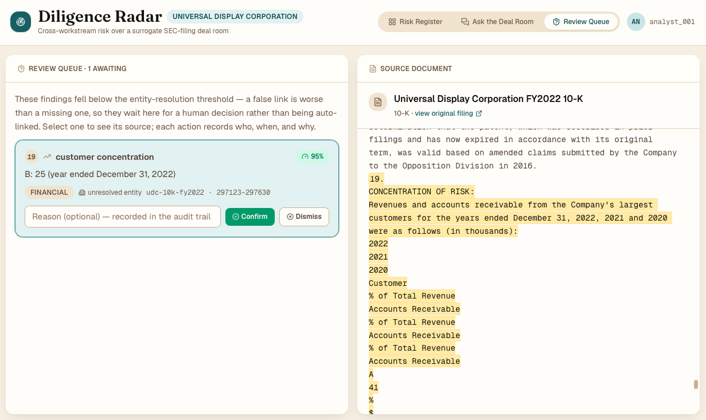
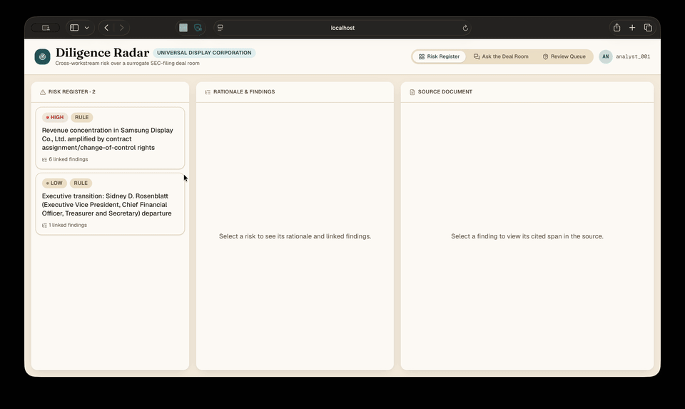
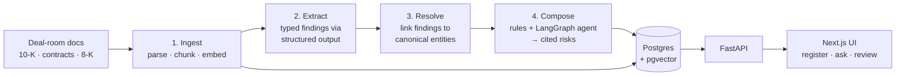

# Diligence Radar — AI-assisted M&A due diligence

A reference prototype showing how LLMs can speed up M&A due diligence **without asking anyone to
trust a black box**. It reads a deal room, pulls out typed findings for each diligence workstream
(financial, commercial, operational), links those findings across workstreams by the entities they
mention, and surfaces the risks that only show up when you join them. Every claim cites the exact
passage it came from, and a human confirms or dismisses it.

The sample deal room uses real, public SEC filings, so the whole thing runs locally and offline.

<table>
  <tr>
    <td width="33%" align="center">
      <a href="docs/media/01-risk-register.png"></a>
      <br><sub><b>Risk register</b>: risk → findings → highlighted source</sub>
    </td>
    <td width="33%" align="center">
      <a href="docs/media/02-ask-the-deal-room.png"></a>
      <br><sub><b>Ask the deal room</b>: grounded, cited answers</sub>
    </td>
    <td width="33%" align="center">
      <a href="docs/media/03-review-queue.png"></a>
      <br><sub><b>Review queue</b>: a human confirms or dismisses</sub>
    </td>
  </tr>
</table>

<details>
<summary>▶ Watch the walkthrough (GIF)</summary>
<br>

</details>

## Why

Diligence teams split the work by workstream. Finance reads the 10-K, legal reads the contracts,
operations reads the 8-Ks. Some of the most important risks sit *between* those piles:

> The 10-K says a single customer is more than 10% of revenue. A licence agreement in the legal
> pile says that same customer can walk away on a change of control. Neither team sees the risk on
> its own.

Diligence Radar is built to catch that kind of compound risk. It treats trust as the core product
requirement. A finding nobody can verify is worth less than having no finding at all.

## What it does

- **Risk register.** Cross-workstream risks rated by severity. Open a risk to see its linked
  findings, then open a finding to see the source document scrolled to the **cited character span,
  highlighted**.
- **Ask the deal room.** Grounded, cited Q&A over the documents (hybrid keyword + vector
  retrieval). If the evidence isn't there, it answers *"insufficient evidence"* rather than guessing.
- **Review queue.** Low-confidence or inferred items wait for an analyst to confirm or dismiss them.
  Each decision is written to an immutable audit trail (who, when, why), and every Q&A query is
  logged too.
- **Measured cycle time.** Each pipeline stage records how long it took, so the time saved is a
  number you can check, not a claim.

## Design principles

- **Citations on everything.** Findings carry character offsets into the source text, and the UI
  always lets you check the original wording.
- **Rules are the floor, the agent is the ceiling.** Deterministic cross-reference rules produce the
  risks you can rely on. A LangGraph agent explores further inferences, but it has to pass its own
  self-check, and anything it emits goes to human review.
- **Calibration over alarm.** Severity is scaled to the deal's own materiality (revenue at risk, not
  a bare percentage), and unrelated signals are never merged just to look dramatic.
- **A reliable "I don't know" is a feature.** The Q&A abstains when the evidence isn't there, and
  the evals test for exactly that.
- **Honest evaluation.** The repo reports precision, recall and faithfulness numbers, and it keeps
  known failures visible instead of tuning them away.

## Scope

This is a **prototype for exploring the pattern**, not a production system.

| In scope | Out of scope |
|---|---|
| A single sample deal room (4 public filings) | Real virtual data room (VDR) connectors, OCR, multi-deal tenancy |
| Three finding types: customer concentration, contract clauses, personnel events | An exhaustive diligence checklist |
| Two cross-reference rules, plus one exploratory agent | A general-purpose risk engine |
| Review workflow and audit log with a placeholder user | Real authentication or SSO (see `web/app/lib/user.ts`) |
| Local development (CORS limited to `localhost:3000`) | Deployment, scaling, hardening |

It does not provide legal, financial or investment advice.

## How it works



**Stack:** Python, FastAPI, Postgres + pgvector, OpenAI (`gpt-4o-mini`, `text-embedding-3-small`),
LangGraph, rapidfuzz, Next.js 16 / React 19 / Tailwind 4, pytest and Promptfoo.

| Path | What's there |
|---|---|
| [`ingest/`](ingest/README.md) | The four-stage pipeline: chunking, extraction, entity resolution, risk composition. **Start here for the design details.** |
| `api/` | FastAPI service: risks, documents, Q&A, review, audit, metrics |
| [`web/`](web/README.md) | Single-page UI |
| [`eval/`](eval/README.md) | Extraction, faithfulness and abstention evals |
| `db/` | `schema.sql` (applied automatically on first boot) and incremental migrations |
| `docs/media/` | Screenshots and the walkthrough GIF used in this README |

## Quickstart

Prerequisites: Docker, Python 3.11+, Node 20+, and an OpenAI API key.

```bash
cp .env.example .env                 # add your OPENAI_API_KEY
docker compose up -d                 # Postgres + pgvector; schema applied on first boot
python3 -m venv .venv && .venv/bin/pip install -r api/requirements.txt

# run the pipeline (safe to re-run: each stage rebuilds its own output)
.venv/bin/python3 ingest/run_ingest.py    # 1. parse, chunk, embed the sample deal room
.venv/bin/python3 ingest/run_extract.py   # 2. typed findings
.venv/bin/python3 ingest/run_resolve.py   # 3. entity resolution
.venv/bin/python3 ingest/run_compose.py   # 4. cross-reference → risks

# serve
cd api && ../.venv/bin/uvicorn app.main:app --reload    # http://localhost:8000/health
cd web && npm install && npm run dev                     # http://localhost:3000 (second shell)
```

Then try a question:

```bash
curl -s -X POST http://localhost:8000/ask -H "Content-Type: application/json" \
  -d '{"question": "what is the customer concentration?"}'
```

`db/migrations/` exists only for databases created before those changes. A fresh
`docker compose up` already gets the full schema.

## Sample data

The sample deal room is **Universal Display Corporation** (OLED technology, CIK 1005284). It uses
four public SEC filings, committed under `ingest/data/raw/` so the demo never touches EDGAR:

| Workstream | Document | What it contributes |
|---|---|---|
| Financial | FY2022 10-K | Customer concentration (Samsung Display, LG Display, BOE) |
| Commercial | Ex. 10.25: OLED patent licence with Samsung Display | Assignment / change-of-control, termination and expiry clauses |
| Operational | 8-K (Aug 2022), Item 5.02, and the press-release exhibit | CFO retirement |

The pipeline's headline output is a **High** risk on Samsung Display Co., Ltd. It is a material
customer, and its licence permits assignment on change of control, with several termination
triggers and a fixed expiry date. Each workstream sees only part of that picture.

The deal's own scale (revenue band, materiality thresholds) lives in `ingest/lib/deal_context.py`.
These are illustrative values for a mid-market acquisition, kept separate from the target's
filings.

## API

| Method | Path | Purpose |
|---|---|---|
| GET | `/health` | Liveness check |
| GET | `/risks` · `/risks/{id}` | Risk register; one risk with its linked findings |
| GET | `/documents/{id}` | Raw document text (for highlighting cited spans) |
| POST | `/ask` | Grounded, cited Q&A with abstention |
| GET | `/review-queue` | Findings awaiting human review |
| PATCH | `/findings/{id}/review` · `/risks/{id}/review` | Confirm or dismiss, with a note |
| GET | `/audit/queries` | Q&A audit log |
| GET | `/metrics/pipeline` | Measured duration of each stage and end to end |

Interactive docs are at `http://localhost:8000/docs` while the API is running.

## Evaluation

Three small evals cover the behaviours that matter most for trust (details in
[`eval/README.md`](eval/README.md)):

| Eval | Result |
|---|---|
| Change-of-control extraction vs. a held-out **CUAD** subset | P = 1.00, R = 0.80, F1 = 0.89 |
| Citation faithfulness (span containment / LLM judge) | 100% / 93% |
| Abstention on unanswerable questions (Promptfoo) | 5/5 |

```bash
.venv/bin/python3 -m pytest eval -s
cd eval/promptfoo && npx promptfoo@0.121 eval -c promptfooconfig.yaml --no-cache
```

## Reusing and extending

- **Your own documents.** Follow the three steps in
  [`ingest/README.md`](ingest/README.md#using-your-own-documents). The chunker uses generic
  structural signals rather than SEC-specific ones, so contracts exported from Word also work.
- **New finding types.** Add a Pydantic schema in `ingest/lib/schemas.py` plus instructions and an
  `extract_*_findings` function in `ingest/lib/extract_findings.py`.
- **New cross-reference rules.** Add a function to `ingest/lib/risk_rules.py` and register it in
  `run_rules`.
- **A different deal size.** Change `DEAL` in `ingest/lib/deal_context.py`. Severity bands follow
  automatically.
- **Different models.** Model names are constants at the top of `api/app/answer.py`,
  `api/app/embed.py`, `ingest/lib/embed.py`, `ingest/lib/extract_findings.py`,
  `ingest/lib/risk_agent.py` and `eval/lib/llm.py`. If you change the embedding model, also check the
  vector dimension in `db/schema.sql`.
- **Real authentication.** Replace `CURRENT_USER` in `web/app/lib/user.ts`. The review and audit
  code paths already use it as the actor.

## License

[MIT](LICENSE)
